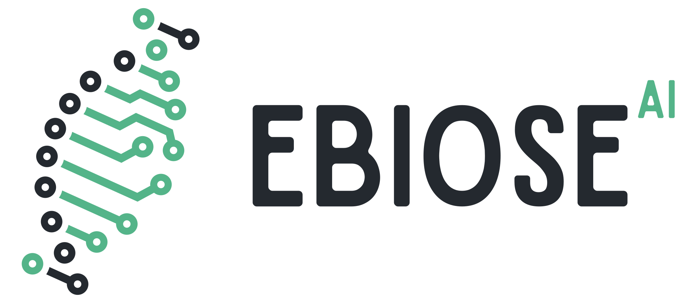

  <picture>
    <source media="(prefers-color-scheme: dark)" srcset="assets/ebiose-logo-dark.svg">
    
  </picture>

  <h3>The self-evolving AI factory</h3>

  <i>Copyright © 2026 Ebiose AI</i>

  <h1>⏳ Our next major release arrives in November 2026 ⏳</h1>

## Agents that improve. A factory that learns to build better ones.

Ebiose is an [Inria](https://www.inria.fr/en) (the French national research institute behind
[scikit-learn](https://scikit-learn.org)) spin-off building an open-source framework for creating and evolving AI
agents. You define a task and how to measure success. Ebiose builds, evaluates, and improves
agents tailored to it.

Our ambition goes further: improve not only the agents, but the way they are created. That
is what we have spent the past 18 months building into our new **Genomic Engine**.

The new framework is in active development. Its code is not public yet. It will launch here
in **November 2026**, under the MIT license.

## While you wait

- **The beta code is still available** at the tag [`beta-0.1`](../../tree/beta-0.1):
  `git clone --branch beta-0.1 https://github.com/ebiose-ai/ebiose.git`
- **Issues and pull requests have been closed.** They targeted the beta code, which the
  rewrite replaces. Thank you to everyone who sent one: the ideas and problems you reported
  have fed the new design. The issue tracker reopens with the new code in November.
- **Follow the work** on [ebiose.com](https://ebiose.com) and come talk to us on
  [Discord](https://discord.com/invite/WuChCBAzEw).

## Thank you

Everyone who contributed to the beta is credited in [AUTHORS.md](AUTHORS.md) and in this
repository's history, which is kept intact.
